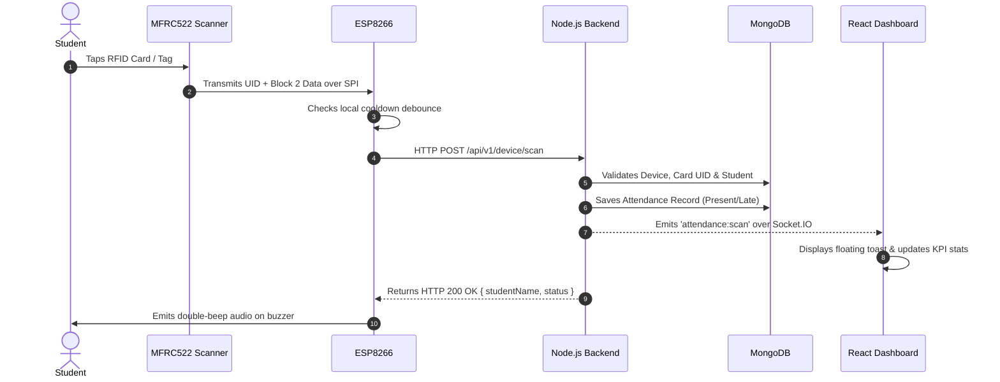

<div align="center">

# 🪪 Smart RFID Attendance Management System

**An enterprise-grade IoT attendance management solution powered by ESP8266 (NodeMCU), MFRC522 RFID, Node.js, Express, MongoDB, and React with real-time Socket.IO streaming.**

[](https://opensource.org/licenses/MIT)
[](https://nodejs.org/)
[](https://react.dev/)
[](https://tailwindcss.com/)
[](https://www.mongodb.com/)
[](https://socket.io/)
[](https://www.espressif.com/)
[](http://makeapullrequest.com)

[Explore Documentation](docs/API_DOCUMENTATION.md) · [Report Bug](https://github.com/Glen-C-John/smart-rfid-attendance-system/issues) · [Request Feature](https://github.com/Glen-C-John/smart-rfid-attendance-system/issues)

</div>

---

## 📖 Table of Contents
- [Overview](#-overview)
- [System Architecture](#-system-architecture)
- [Key Features](#-key-features)
- [Hardware Pinout & Wiring](#-hardware-pinout--wiring)
- [Tech Stack](#-tech-stack)
- [Quick Start Guide](#-quick-start-guide)
- [Environment Configuration](#-environment-configuration)
- [Flashing Firmware](#-flashing-firmware)
- [Admin Dashboard Modules](#-admin-dashboard-modules)
- [API Reference](#-api-reference)
- [Automated Testing](#-automated-testing)
- [License](#-license)

---

## 🌟 Overview

The **Smart RFID Attendance Management System** transforms traditional manual roll calls and basic logging sketches into a robust, high-performance IoT ecosystem.

It pairs an **ESP8266 NodeMCU** and an **MFRC522 RFID module** with a **Node.js/Express REST backend**, a **MongoDB database**, and an interactive **React Admin Dashboard**. When a student taps their RFID badge at the scanner, their attendance is recorded in MongoDB, audio feedback is sounded on the hardware buzzer, and a live notification card instantly pops up on the administrator's dashboard via WebSockets.

---

## 🏗️ System Architecture

```
                                      +------------------------------------+
                                      |          MongoDB Database          |
                                      |   (Students, Cards, Attendance,    |
                                      |       Devices, Settings)           |
                                      +-----------------+------------------+
                                                        │
                                                   Mongoose ORM
                                                        │
+--------------------------+          HTTP / HTTPS      ▼
│     ESP8266 NodeMCU      │ ───────────────────> +────────────────────────+
│  + MFRC522 RFID Reader   │    POST /device/scan │  Node.js + Express API │
│  + LittleFS Offline Queue│                      │  Port: 5001            │
+--------------------------+                      +───────────┬────────────+
                                                              │
                                                      Socket.IO Events &
                                                          REST API
                                                              │
                                                              ▼
                                                  +────────────────────────+
                                                  |   React 18 Admin App   |
                                                  |  (Tailwind + Recharts) |
                                                  |   Port: 3000           |
                                                  +────────────────────────+
```

### End-to-End Scan Data Flow:


---

## 🚀 Key Features

### 🔌 IoT Hardware & Firmware
- **Dual-Layer Tag Acquisition:** Simultaneously acquires the unique 4-byte factory hardware UID and Sector 0, Block 2 payload.
- **Smart Auto-Enrollment:** Seamlessly binds physical RFID cards to student records on first tap.
- **LittleFS Offline Queue:** Continues capturing attendance during network drops and automatically flushes buffered scans when Wi-Fi recovers.
- **Debounce Throttling:** Built-in cooldown suppression prevents accidental double-swipes.
- **Audio Feedback:** Multi-tone buzzer feedback (success confirmation, duplicate scan chirp, network offline beep, error buzz).

### 🖥️ Full-Stack Web Platform
- **Real-Time Streaming:** Instant scan alerts and stats updates via Socket.IO without page refreshes.
- **Interactive Analytics:** Weekly attendance trend AreaCharts, status distribution Donut charts, and class cohort comparison BarCharts using Recharts.
- **Student & Card Management:** Paginated search, class filters, detailed student profiles, and one-click RFID card blocking/revocation.
- **Manual Attendance Correction:** Administrators can adjust attendance status or timestamps with mandatory audit reason logging.
- **Comprehensive Reporting:** Export daily, weekly, monthly, and custom reports to clean **CSV** or styled **PDF** with formatted tables.
- **Dynamic System Preferences:** Configure workday start times, late arrival thresholds, scan cooldowns, and operational timezone (`Asia/Kolkata`).

---

## 📌 Hardware Pinout & Wiring

The wiring between the **NodeMCU ESP8266** and the **MFRC522 RFID reader** uses standard hardware SPI:

| MFRC522 Pin | NodeMCU Pin | GPIO | Function |
|---|---|---|---|
| **SDA** (SS) | **D2** | GPIO 4 | SPI Slave Select / Chip Enable |
| **SCK** | **D5** | GPIO 14 | SPI Serial Clock (1 MHz) |
| **MOSI** | **D7** | GPIO 13 | Master Out Slave In |
| **MISO** | **D6** | GPIO 12 | Master In Slave Out |
| **IRQ** | *Unconnected* | — | Not needed for polling |
| **GND** | **GND** | — | Common Ground |
| **RST** | **D1** | GPIO 5 | Hardware Reset |
| **3.3V** | **3V3** | — | Power (⚠️ **Do NOT connect to 5V/VIN!**) |

### Audio Buzzer:
- **Buzzer (+)** ➔ NodeMCU **D8** (GPIO 15)
- **Buzzer (-)** ➔ NodeMCU **GND**

---

## 🛠️ Tech Stack

- **Microcontroller:** ESP8266 NodeMCU (ESP-12E)
- **RFID Module:** NXP MFRC522 (13.56 MHz RFID / NFC)
- **Backend Framework:** Node.js, Express.js
- **Database:** MongoDB (Local or MongoDB Atlas) with Mongoose ORM
- **Real-Time Engine:** Socket.IO
- **Frontend Framework:** React 18, Vite
- **Styling:** Tailwind CSS, Lucide React Icons
- **Data Visualization:** Recharts
- **Document Generation:** jsPDF, jspdf-autotable
- **Testing:** Jest, Supertest

---

## ⚡ Quick Start Guide

### Prerequisites
- [Node.js (v18+)](https://nodejs.org/)
- [MongoDB](https://www.mongodb.com/) (running locally on port 27017 or a MongoDB Atlas URI)
- [Arduino IDE](https://www.arduino.cc/en/software) or `arduino-cli`

### 1. Clone the Repository
```bash
git clone https://github.com/Glen-C-John/smart-rfid-attendance-system.git
cd smart-rfid-attendance-system
```

### 2. Install Dependencies
```bash
# Backend dependencies
cd backend && npm install

# Frontend dependencies
cd ../frontend && npm install
cd ..
```

### 3. Start Local MongoDB (if running locally)
```bash
mongod --dbpath backend/data/db --port 27017
```

### 4. Run the Backend & Frontend
In two separate terminals:
```bash
# Terminal 1: Start Backend API (Port 5001)
npm run start:backend

# Terminal 2: Start React Admin Dashboard (Port 3000)
npm run start:frontend
```

Open your browser to 👉 **`http://localhost:3000`**  
Default Admin Credentials:
- **Username:** `admin`
- **Password:** `admin123`

---

## ⚙️ Environment Configuration

Copy `backend/.env.example` to `backend/.env` and update the parameters:

```env
# Server Configuration
PORT=5001
NODE_ENV=development

# Database Connection
MONGODB_URI=mongodb://localhost:27017/rfid_attendance

# Operational Timezone
TIMEZONE=Asia/Kolkata

# Authentication Keys & Admin Credentials
ADMIN_API_KEY=admin_super_secret_key_change_in_production
ADMIN_USERNAME=admin
ADMIN_PASSWORD=admin123
JWT_SECRET=super_secret_jwt_key_rfid_attendance_2026

# IoT Device Defaults
DEFAULT_DEVICE_ID=ESP8266_001
DEFAULT_DEVICE_KEY=esp8266_device_secret_token_123

# Attendance Rules
ATTENDANCE_COOLDOWN_SECONDS=60
CHECKOUT_MIN_INTERVAL_MINUTES=5
WORK_DAY_START_TIME=09:00
LATE_THRESHOLD_TIME=09:30
ENABLE_CHECKOUT=true
DEVICE_HEARTBEAT_THRESHOLD_SECONDS=180
```

---

## 📡 Flashing Firmware

1. Open `firmware/esp8266_rfid_node/esp8266_rfid_node.ino` in Arduino IDE or compile via `arduino-cli`.
2. Configure your Wi-Fi credentials and server endpoint:
   ```cpp
   #define WIFI_SSID       "Your_WiFi_SSID"
   #define WIFI_PASSWORD   "Your_WiFi_Password"
   #define BACKEND_SCAN_URL "http://<YOUR_COMPUTER_IP>:5001/api/v1/device/scan"
   ```
3. Connect your NodeMCU via USB and upload:
   ```bash
   arduino-cli compile --fqbn esp8266:esp8266:nodemcuv2 firmware/esp8266_rfid_node
   arduino-cli upload -p /dev/cu.usbserial-0001 --fqbn esp8266:esp8266:nodemcuv2 firmware/esp8266_rfid_node
   ```

---

## 📊 Admin Dashboard Modules

| Module | Route | Highlights |
|---|---|---|
| **Executive Dashboard** | `/` | 8 live KPI statistic cards, real-time weekly attendance trend charts, status breakdown, and recent activity stream |
| **Student Management** | `/students` | Searchable directory, class cohort filters, student registration/edit modal, detailed attendance profiles |
| **RFID Cards** | `/cards` | Active/blocked inventory table, instant card blocking for lost cards, new card registration |
| **Attendance Logs** | `/attendance` | Date preset filters (Today, 7D, 30D), manual attendance correction modal with mandatory audit trail logging |
| **Device Monitor** | `/devices` | Real-time online/offline status calculated from device heartbeat windows, token regeneration |
| **Reports & Export** | `/reports` | Aggregated summaries, one-click export to clean **CSV**, one-click formatted **PDF** generation |
| **System Settings** | `/settings` | Institutional policies, cooldown windows, work hours, and timezone preferences |

---

## 📚 API Reference

See the full [REST API & WebSocket Documentation](docs/API_DOCUMENTATION.md) for detailed payload schemas.

### Primary Endpoints:
- `POST /api/v1/auth/login` — Administrator JWT login
- `POST /api/v1/device/scan` — IoT card scan endpoint (Device Authenticated)
- `GET /api/v1/dashboard/overview` — Live statistical overview
- `GET /api/v1/dashboard/trends` — 7-day attendance time series
- `GET /api/v1/students` — Paginated student query & filters
- `GET /api/v1/cards` — RFID card inventory & mapping
- `GET /api/v1/attendance` — Master attendance query & filters
- `PATCH /api/v1/attendance/:id` — Manual attendance correction with audit justification
- `GET /api/v1/reports` — Analytical report generator
- `GET /api/v1/settings` — Current institutional settings

---

## 🧪 Automated Testing

The backend includes comprehensive integration tests covering device authentication, card validation, duplicate scan prevention, LittleFS queue processing, admin CRUD operations, and Google Sheets migration idempotency.

Run tests:
```bash
npm run test
# Or:
cd backend && npm test
```

---

## 📄 License

This project is licensed under the MIT License - see the [LICENSE](LICENSE) file for details.

---

<div align="center">
  <sub>Developed by <b>Glen John</b>. Built for reliable IoT attendance automation.</sub>
</div>
